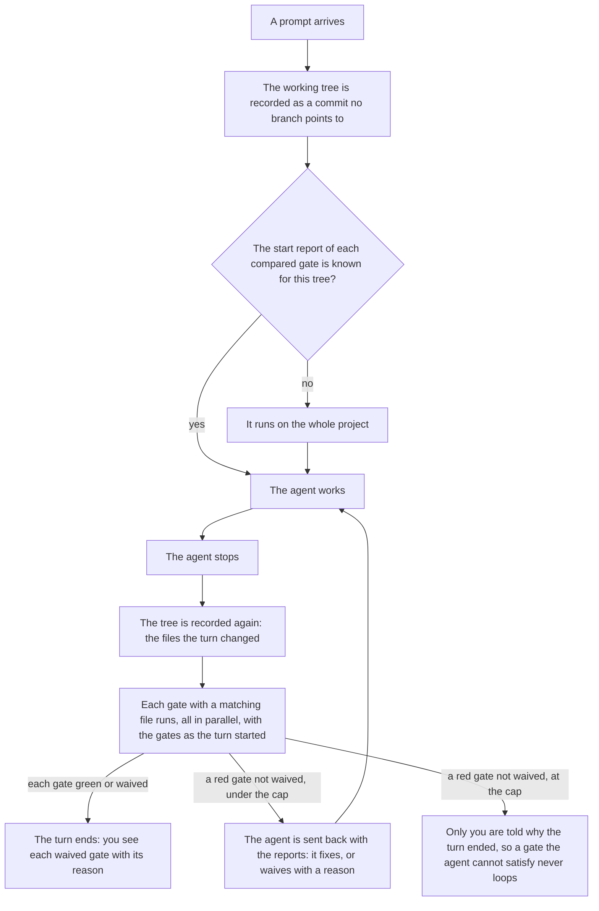
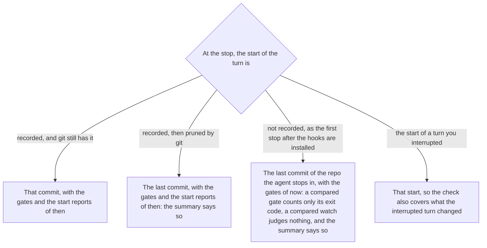
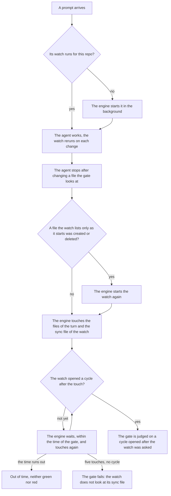
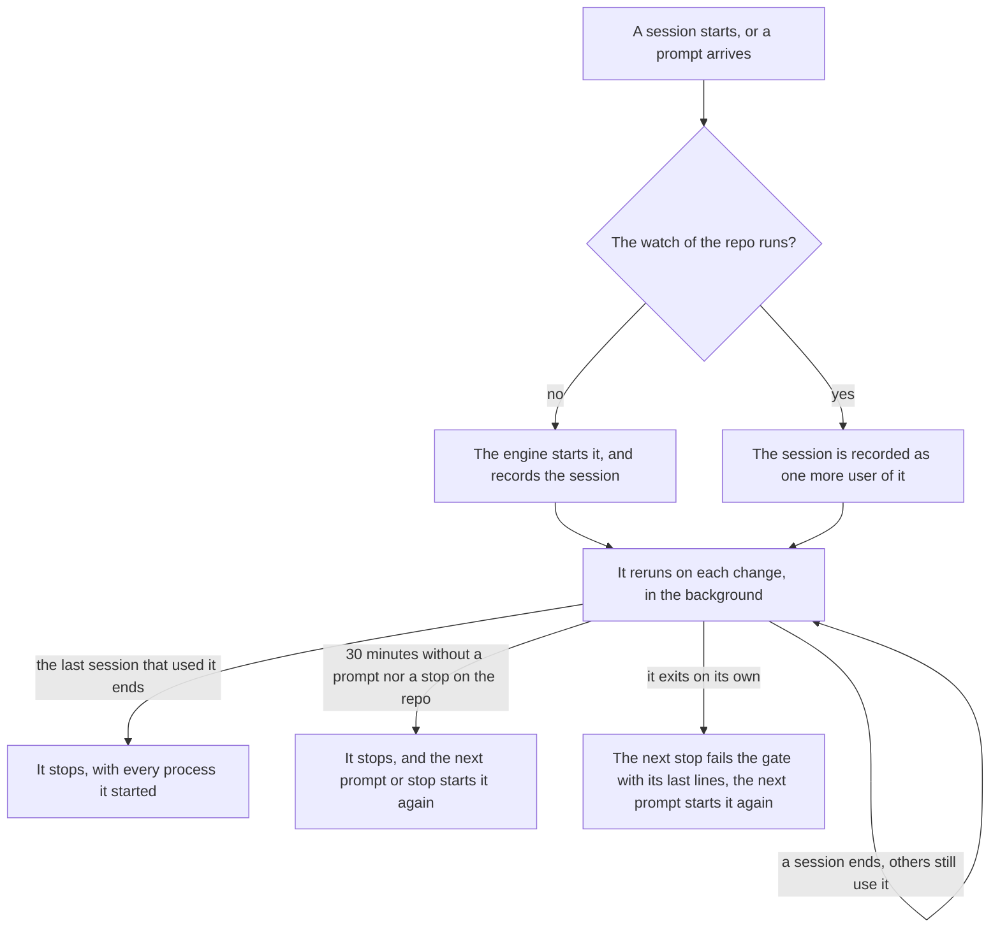

# How a turn is checked, in detail

The README gives the steps. This page draws them, with what the engine does around them.

## The turn



The start commit lives among the loose objects of `.git` until git prunes it, like any object nothing points to. The send-backs and the waivers belong to the turn: each stop adds to them, and the next prompt starts from none.

## The waivers

The agent may leave a gate red only when it cannot be fixed (the report is wrong, or fixing it would loop until the last send-back), when fixing it goes against what you asked, or when you have to settle a question first. It then writes, in its last message, after a blank line, one line per gate:

```
[deterministic-gates:<gate>]: waive "<reason>"
```

It is a markdown link definition, which Codex hides. Claude Code prints it raw, so the plugin hides it there: a mod draws each reply without it, a resumed session included, and a `MessageDisplay` hook does the same where mods do not run. Only the display changes: the stored message, the one the stop reads, keeps it. The summary shows the gate in orange ⚠, with the reason under it.

The engine reads the waive lines of the agent's last message as the host hands it over at the stop, and keeps them with the turn. A waiver is bound to the report the agent saw: the one of the stop before, or of this stop when the agent waives before it is sent back. It falls as soon as the report of its gate says something else, and the agent is sent back to judge it again. The numbers of a report do not count, since an edit above a problem moves its line and a runner prints how long it took. A waive line for a gate that is green is let go, and one that names no gate of the turn is pointed out to the agent. A waiver ends with its turn, and `check`, so CI, never reads one: a gate that fails there fails.

## Where the start comes from



The check runs in the repo the turn started in, whatever folder the agent stops in.

## The files of the turn

A deleted file counts as changed, so a gate that reads the whole project runs on it. It is never named, though: a gate given `{files}` looks at the files left, and is skipped when none is left. `{files}` is an argument of its own, `{turn}` can stand anywhere in one, and `{engine}/` only ever starts the first word of `run`.

When HEAD moves during the turn to code the turn did not write, by a checkout, a pull, a merge, a rebase or a reset, what came with it is not the turn's. The engine does not read how HEAD moved: it knows which commits were there: the ones a branch held as the session first started a turn in the repo, the one each of its turns started on, and the ones committed before the turn, as a fetch brings. Any other commit is one the session made, in whatever worktree, and stays so in its later turns. When the commits that were there under HEAD are not the ones the turn started on, a file like the one any of them holds came with it: the files of the turn are the others, and `{turn}` is the commit that brought the code. A turn that only changes branch checks nothing, and the summary says HEAD moved. A turn that leaves its branch and comes back is checked as any other, and a commit the session left on another branch is judged by the turn of the session that brings it back. The reports the compared gates started from are of the code HEAD left: a gate whose `lineKey` has a group named `file` counts only the lines that name a file of the turn, and another one is not compared, which the summary says. Three limits follow. The dates are the ones the commits give: a commit an agent dates before its turn passes for one that was there, and one a teammate pushed during the turn, then pulled, passes for the turn's. A file both sides of a merge or a rebase changed is judged, though git merged it alone. And a commit the session made that no branch holds at the stop of its turn, as one on a deleted branch, is not judged when a later turn brings it back.

A gate runs from the root of the repo, with colour turned off. Its report is cut to the first and last lines past 4000 characters, with the root path left out.

## The gates that keep a watch

A gate that keeps a watch is judged on the watch instead of running:



A watch lives across turns and sessions:



## The compared gates

A compared gate fails on the lines of output the turn added: the lines its start report does not hold as they are, so a problem that moves to another line or is reworded counts as new too, unless its `lineKey` says otherwise. The lines stay new in the next turns until they are fixed: a report the agent leaves failing is not the next turn's baseline.

The command exits with 0 when it finds problems, as `knip --no-exit-code` or `gofmt -l` do. Any other exit code is the command that broke, even when it printed the same thing as the turn started.

## A gate that breaks

A gate that breaks is not a gate that found a problem: its command is missing or broke, as a compared gate that exits with another code than 0 does, or another gate with one of its `brokenExitCodes`, or its watch stopped. It still fails the turn, even when it broke before the turn started: nothing tells a gate the agent broke two turns ago from one a missing dependency broke, and a gate excused for being broken already would be the cheapest way out of it. The agent is told to repair what stops the gate from running rather than to fix the code, and waives it when it cannot.

The prompt's hook has 60 s, so the start reports have 45 s, together: a command still running then gives none, and the stop says the gate had no report to compare with. The turn is recorded before they run, so a hook stopped anyway still ends the turn before, its send-backs with it.

## What the engine keeps

The turn of each session, the last reports of each repo, and the process and output of each watch, in the temporary folder of the system. It writes nothing in the repo, and the folder is the system's to clean.

## What the lock covers

The two gates files alone: an agent that edits `.gates.json` or `.gates.local.json` mid-turn changes the next turn, never its own, and the summary says so. The configuration of a tool, such as `tsconfig.json` or `eslint.config.js`, is read as it is when the gate runs, and only the conduct the agent is told keeps it from weakening one. The `no-new-suppressions` gate of the catalog refuses the other way out, the rule silenced in the code.

## The whole check

`npx @tayomi/deterministic-gates check` runs every gate on every file of the repo that matches, committed or not, as if one turn had written it all: a compared gate counts every line of its report. The summary and the failed reports print. The command exits with 1 when a gate fails, and with 2 when it cannot run: outside git, without a gates file, or with one it cannot read.

`check --format json` prints the same check for a tool to read, such as a CI or a script, with the same exit codes:

```json
{
  "ok": false,
  "durationMs": 7040,
  "gates": [
    { "name": "lint", "status": "failed", "durationMs": 900, "report": "src/a.ts:3 no-unused-vars" },
    { "name": "typecheck", "status": "passed", "durationMs": 1100 },
    { "name": "format", "status": "skipped" }
  ],
  "notes": []
}
```

| `status`    | The gate                                         | It also holds          |
| ----------- | ------------------------------------------------ | ---------------------- |
| `passed`    | Ran and found nothing.                           | `durationMs`           |
| `failed`    | Found a problem.                                 | `durationMs`, `report` |
| `broken`    | Could not run: its `report` says what stops it.  | `durationMs`, `report` |
| `timed-out` | Ran out of time, so it is neither green nor red. | `durationMs`           |
| `skipped`   | Looks at no file of the repo.                    |                        |

`ok` is false when a gate failed or broke, and a `report` is whole, where the agent gets an excerpt.
