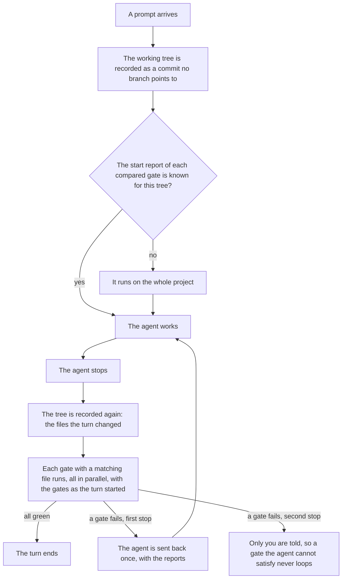
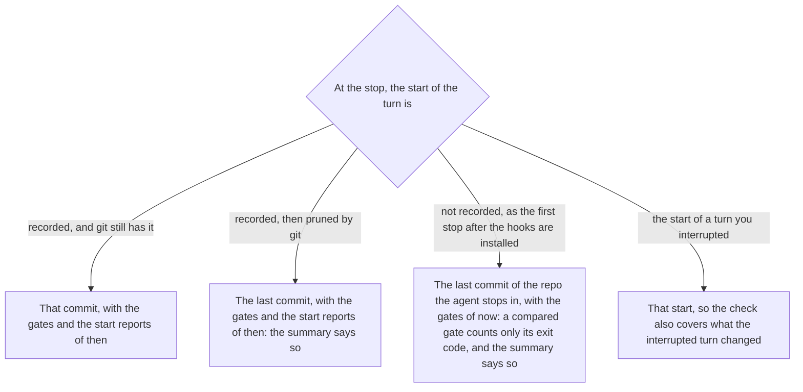

# How a turn is checked, in detail

The README gives the four steps. This page draws them, with what the engine does around them.

## The turn

The start commit lives among the loose objects of `.git` until git prunes it, like any object nothing points to. The retry is told by the flag the agent sends with its stop: when another Stop hook of yours sends the agent back first, the engine takes its next check for the retry and sends nobody back.

## Where the start comes from

The check runs in the repo the turn started in, whatever folder the agent stops in.

## The files of the turn

A deleted file counts as changed, so a gate that reads the whole project runs on it. It is never named, though: a gate given `{files}` looks at the files left, and is skipped when none is left. `{files}` is an argument of its own, `{turn}` can stand anywhere in one, and `{engine}/` only ever starts the first word of `run`.

A gate runs from the root of the repo, with colour turned off. Its report is cut to the first and last lines past 4000 characters, with the root path left out.

## The compared gates

A compared gate fails on the lines of output the turn added: the lines its start report does not hold as they are, so a problem that moves to another line or is reworded counts as new too. The lines stay new in the next turns until they are fixed: a report the agent leaves failing is not the next turn's baseline.

The command exits with 0 when it finds problems, as `knip --no-exit-code` or `gofmt -l` do. Any other exit code fails the gate, even when it printed the same thing as the turn started.

## What the engine keeps

The turn of each session and the last reports of each repo, in the temporary folder of the system. It writes nothing in the repo, and the folder is the system's to clean.

## What the lock covers

The two gates files alone: an agent that edits `.gates.json` or `.gates.local.json` mid-turn changes the next turn, never its own, and the summary says so. The configuration of a tool, such as `tsconfig.json` or `eslint.config.js`, is read as it is when the gate runs, and only the conduct the agent is told keeps it from weakening one. The `no-new-suppressions` gate of the catalog refuses the other way out, the rule silenced in the code.

## The whole check

`node src/cli.ts check` runs every gate on every file of the repo that matches, committed or not, as if one turn had written it all: a compared gate counts every line of its report. The summary and the failed reports print. The command exits with 1 when a gate fails, and with 2 when it cannot run: outside git, without a gates file, or with one it cannot read.
